# Fish-farm vision on public data

<p align="center">
  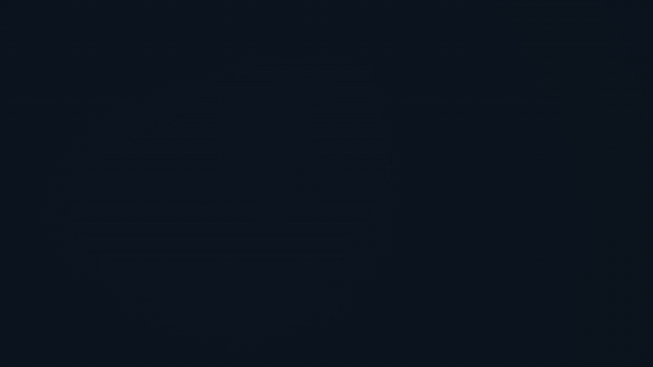
</p>
<p align="center"><sub>Left: a Brackish clip as filmed. Right: the same clip after gray-world + CLAHE colour correction.
<a href="media/fish-farm-vision.mp4">Watch the 80-second video.</a></sub></p>

I spent a day testing what public datasets and current vision models can do for cameras on fish farms. Claude Code
wrote and ran the experiments on rented cloud GPUs. I picked the questions and checked the results. Each setting was
run once, on two public datasets, so read the numbers as a first look rather than a benchmark.

## What I found

- **The usual way to split these datasets can make a model look more than twice as good as it is.** On Brackish, with
  the same model and the same test frames, the score was 0.72 when training and test frames were drawn at random from
  the same videos, and 0.31 when whole videos were kept apart.
- A trout-farm dataset shows the same effect over time. YOLO26-S scored 0.95 on the published random split
  and 0.83 when tested on photos taken after the training photos (AP50, with somewhat less training data).
- On videos no model had seen, RF-DETR-M scored best (0.380). Grounding DINO, which never trained on this data, came
  close (0.375). In the YOLO family, the 2021 YOLOX-L (0.331) beat the 2026 YOLO26-L (0.301).
- A tenth of the labels did about as well as all of them: 0.377 against 0.380.
- Colour correction made the footage easier to look at. It did not help the detector.
- Telling a dead fish from a live one worked only with large commercial models: 82 to 96% correct on 120 fish from
  one farm. Open models up to 32B parameters did no better than a coin flip. Synthetic training data, detectors used
  without training on this data, and a "dead fish stay put" rule all failed.

## Data and compute

| Dataset | What it is | Used for | License |
|---|---|---|---|
| [Brackish](https://www.kaggle.com/datasets/aalborguniversity/brackish-dataset) | 89 short videos from a fixed camera 9 m deep in the Limfjord, Denmark. 14,674 frames at 1920x1080, six kinds of animal: fish, small fish, crab, shrimp, starfish, jellyfish. I used the [Roboflow export on Hugging Face](https://huggingface.co/datasets/dronefreak/Brackish). | detection, the split test, enhancement | CC BY-SA 4.0 |
| [RAS-MortDB v1.1.0](https://doi.org/10.5281/zenodo.21829219) | Time-lapse photos of the drain plate in a trout tank on a farm, one every 15 minutes, in 20 recording sessions between October and December 2022. Dead and live trout are boxed. | dead fish, the split over time | CC BY 4.0 |
| UIEB | 890 underwater photos, each with a chosen enhanced version as reference | training and scoring NAFNet | not included here |
| Fish-Vista | Museum photos of preserved fish. I used only the 1,499 CC0 and CC BY photos. | synthetic dead fish | CC0 / CC BY |

Compute was a few rented cloud GPUs for about a day. Training one detector took between ten minutes and an hour and a
half.

The dead-or-alive test compared three large commercial multimodal models, called A, B and C below, with the open
Qwen3-VL models (2B, 8B and 32B) running on a single GPU.

**How to read the scores.** Detection scores are COCO AP, from 0 to 1. To score well, a detector has to find each
animal, name it correctly and draw a tight box. AP50 is a looser version that accepts any box overlapping the true one
by at least half. In the dead-fish results, *precision* is the share of "dead" calls that were right, and *recall* is
the share of dead fish that were found.

## 1. Image enhancement: nicer to look at, no better to detect

<table>
  <tr><th>As filmed</th><th>CLAHE</th></tr>
  <tr><td>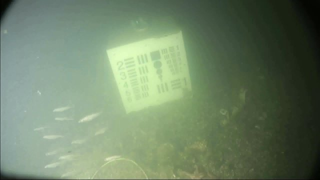</td>
      <td>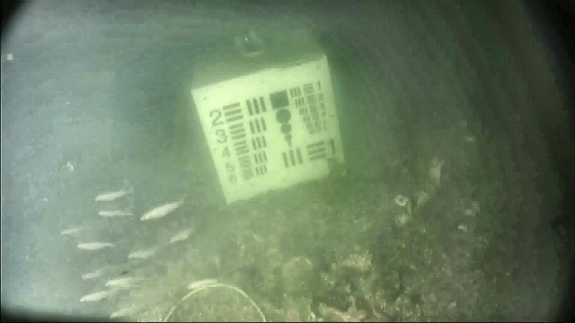</td></tr>
  <tr><th>Gray-world + CLAHE</th><th>MSRCR</th></tr>
  <tr><td>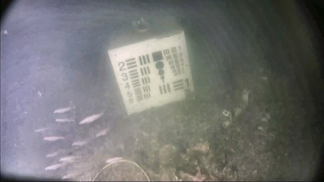</td>
      <td>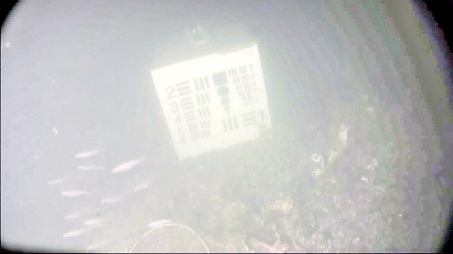</td></tr>
</table>

Underwater footage turns green and flat because water absorbs red light first and scatters the rest. I tried five
fixes. CLAHE boosts local contrast. Gray-world rebalances the colour channels. I also tried the two together, MSRCR
(a classic Retinex method), and NAFNet, a neural network I trained on UIEB's photo pairs.

NAFNet did learn something. On 90 UIEB photos it never trained on, it scored a PSNR of 22.0 dB, against 17.5 dB for
the uncorrected photo (higher means closer to the reference). Published methods report about 24.7 dB on UIEB's
standard 90-photo test set, so this is a fair result, not a top one.

Better-looking images did not give better detection. Here is YOLO26-S on the 15 test videos described in section 2 (AP):

| Trained on ↓ / tested on → | raw | CLAHE | NAFNet |
|---|---|---|---|
| raw | **0.294** | 0.215 | 0.248 |
| CLAHE | 0.246 | **0.291** | not run |
| NAFNet | 0.225 | not run | **0.301** |

When the training and test images match (bold), correction moves the score by 0.01 at most. A change that small could
be run-to-run noise, and I ran each setting once. When they don't match, the score drops by 0.05 to 0.08. A detector
gets used to the colours it was trained on. Fixing the colours doesn't tell it anything new about the animals.

## 2. The test split matters more than the model

<p align="center">
  <picture>
    <source media="(prefers-color-scheme: dark)" srcset="figures/split_diagram-dark.svg">
    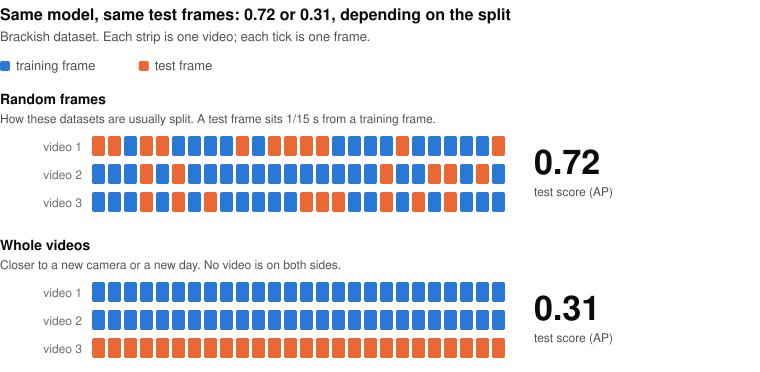
  </picture>
</p>

Brackish frames come from short videos at 15 frames per second, so neighbouring frames look almost the same. The
Roboflow export puts every one of the 89 videos into training, validation and test at once. All 1,468 of its test
frames come from videos that are also in training. The split script in the original release shuffles frames at
random too.

I re-split Brackish by video: 64 videos for training (10,387 frames), 10 for validation (1,544) and 15 for testing
(2,743). I tried 200 random shuffles of the videos and kept the one where each animal's share of the test and
validation sets came closest to 20% and 10%. Rare animals still appear in only a few videos, so the scores for jellyfish (74 boxes) and shrimp (109 boxes) are noisy.

To check that the gap comes from the split and nothing else, I ran a controlled test. There was one fixed test set:
half the frames of the 15 test videos, 1,371 frames. There were two training sets, each with 8,829 frames. The only
difference was that the second one included 1,017 frames from the other half of the test videos.

| YOLO26-S trained on | AP | AP50 |
|---|---|---|
| training videos only | 0.314 | 0.524 |
| training videos plus frames from the test videos | 0.721 | 0.976 |

The model, the settings and the test frames were the same. The pattern also shows up inside a single model. Scored on
frames set aside from the videos it trained on, it got 0.749. On new videos it got 0.310.

**RAS-MortDB, split over time.** The published split picks time-lapse photos at random, so every recording session
in the test set also appears in training. I kept the photos in time order instead. I trained on the first 15 sessions, validated on the
16th and tested on the last 4 (300 photos, 3 to 22 December 2022).

| Model | Test photos | AP | AP50 |
|---|---|---|---|
| authors' released weights | authors' random test set | 0.685 | 0.947 |
| YOLO26-S on the authors' random split | authors' random test set | 0.681 | 0.949 |
| YOLO26-S on the first 15 sessions | last 4 sessions | 0.534 | 0.827 |

There are two caveats. First, the time-ordered training set is smaller: 1,585 unique photos, against 2,800 training
photos in the published split, which include Roboflow's augmented copies. So part of the drop comes from having less data. Second, a
near-duplicate check is weak evidence on this dataset. 83% of the authors' test photos have a near-identical photo in
training, but so do 74% of my later-session photos, because the camera never moves. The time-ordered split is closer
to how a farm would use a model: trained on past weeks, run on the next ones.

## 3. Which detector

<p align="center">
  <picture>
    <source media="(prefers-color-scheme: dark)" srcset="figures/detectors-dark.svg">
    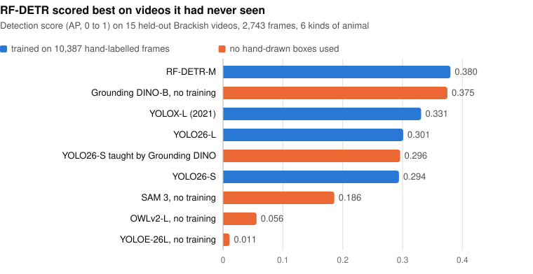
  </picture>
</p>

| Model | Hand-labelled frames | AP | AP50 | Fish AP¹ | Any-animal AP² |
|---|---|---|---|---|---|
| RF-DETR-M | 10,387 | **0.380** | **0.643** | 0.418 | 0.351 |
| Grounding DINO-B, no training | 0 | 0.375 | 0.588 | **0.478** | **0.420** |
| YOLOX-L (2021) | 10,387 | 0.331 | 0.557 | 0.285 | 0.254 |
| YOLO26-L | 10,387 | 0.301 | 0.475 | 0.312 | 0.270 |
| YOLO26-S taught by Grounding DINO | 0 | 0.296 | 0.468 | 0.351 | 0.335 |
| YOLO26-S | 10,387 | 0.294 | 0.498 | 0.292 | 0.263 |
| SAM 3, no training | 0 | 0.186 | 0.360 | 0.334 | 0.256 |
| OWLv2-L, no training | 0 | 0.056 | 0.078 | 0.238 | 0.135 |
| YOLOE-26L, no training | 0 | 0.011 | 0.026 | 0.046 | 0.026 |

¹ Fish and small fish merged into one class. ² Every animal counted as one class, so this only asks whether the model
found the animal, whatever it called it.

Grounding DINO is an open-vocabulary detector. You give it words such as "fish", "crab" or "starfish", and it draws
boxes around things that match. I gave it the six class names and nothing else. Of the models tested here, it was the
best at finding fish and at finding animals at all.

"Taught by Grounding DINO" means I ran Grounding DINO on the training videos, kept its confident boxes as labels, and
trained YOLO26-S on them. No human-drawn box was used. It matched the same model trained on human labels (0.296
against 0.294). I also tried keeping only boxes that persist across neighbouring frames. That made the labels more
accurate (precision against the human labels rose from 0.59 to 0.64) but the trained model slightly worse (0.281).

On the validation videos, YOLO26-L peaked at epoch 24 (0.312) and ended at 0.267 after 50 epochs, which suggests it
was memorising the training videos. Running YOLO26-S at 1280 px instead of 640 px did not help (0.275), so image size does
not explain why it trails Grounding DINO.

## 4. How many labels you need

<p align="center">
  <picture>
    <source media="(prefers-color-scheme: dark)" srcset="figures/label_curve-dark.svg">
    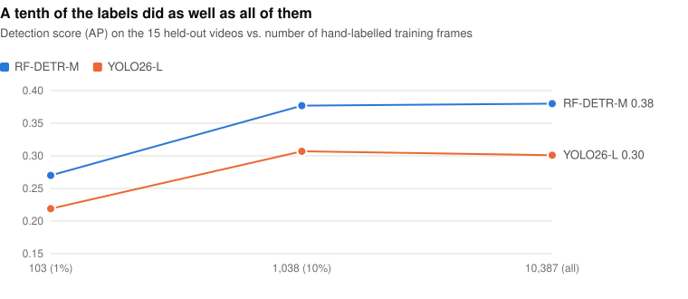
  </picture>
</p>

With 1,038 labelled frames (10%), RF-DETR-M scored 0.377. With all 10,387 it scored 0.380. YOLO26-L went from 0.307
to 0.301. At 1% (103 frames), both dropped clearly. My reading is that 64 training videos hold many near-identical
frames, so after the first thousand, extra labels add little. More videos would probably help more than more frames.

## 5. Dead fish

Removing dead fish is daily work on every farm, and the dead-fish count is one of the main numbers a farm tracks. I
wanted to see how far public data gets you.

There isn't much. I found no public video of dead fish in sea cages. RAS-MortDB is the closest: a real farm, real
deaths and a camera over the drain plate of a trout tank. Everything below uses its later-session test set (300
photos, 933 dead fish).

### What did not work

| Approach | Dead-fish AP50 | Precision / recall at confidence 0.5 |
|---|---|---|
| YOLO26-S trained on the first 15 sessions (for reference) | 0.901 | 0.94 / 0.79 |
| same, but a dead fish must be in the same place in the neighbouring photo | 0.497 | 0.97 / 0.41 |
| Grounding DINO, prompt "dead fish" | 0.454 | 0.80 / 0.06 |
| Grounding DINO finds fish, then CLIP decides dead or alive | 0.240 | no boxes above 0.5 |
| YOLO26-S trained on synthetic dead fish | 0.000 | 0 / 0 |

**The stay-put rule.** A dead fish can't swim off, so I expected it to be in the same place in the next photo.
In this data, only 13.9% of dead fish were in the same place 15 to 120 minutes later (5.9% of live fish). Dead fish
collect at the drain, and the current keeps moving them. The idea may still work over seconds of real video, where a
dead fish shows no gill or fin movement. I had no real video of dead fish to test it on. A simulation, with synthetic
dead fish pasted into Brackish video, was too easy to tell me anything.

**Synthetic dead fish.** I pasted museum photos of preserved fish onto real Brackish frames, with a model of how water
changes colour plus a net texture. The detector trained on them rarely raised a false alarm on normal video (7.7 per
1,000 frames), but it found none of the real dead trout. Museum fish are photographed from the side on a white table.
Dead trout on a drain plate are seen from above, pale and bent.

**Asking for "dead fish" by name.** On Brackish video with no dead fish in it, Grounding DINO's "dead fish" prompt fired on
47.6% of frames.

### What worked

A normal detector trained on real farm photos worked. Its dead-fish AP50 was 0.90. At confidence 0.5,
94% of its "dead" calls were right and it found 79% of dead fish.

Large multimodal models also worked when given a short checklist. I cut out 120 fish from the later-session photos (60
dead, 60 alive). Each one became three tiles: the whole photo with the fish boxed, a close-up, and the same spot in the
neighbouring photo. Every model got [the same checklist](data/dead-or-alive-120/prompt_frontier_models.txt): belly
up and pale, lying on the plate, body rigid, no motion blur, and so on. Each one judged all 120 without seeing the
labels. The labels stayed sealed until every model had answered.

| Dead (all models right) | Alive (all models right) | Labelled dead, all three large models said alive |
|---|---|---|
| 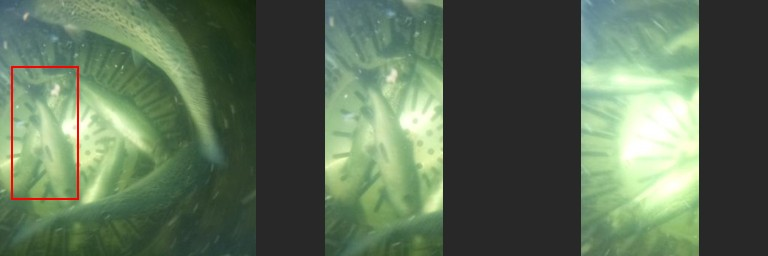 | 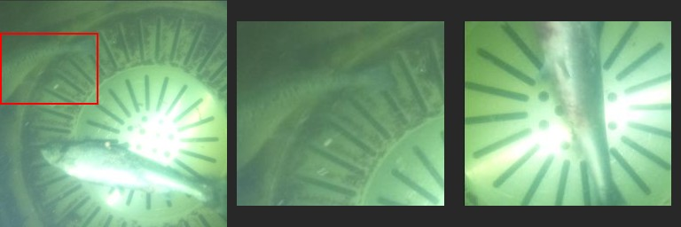 | 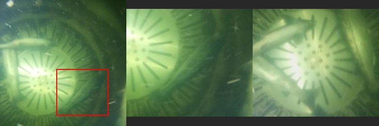 |

<p align="center">
  <picture>
    <source media="(prefers-color-scheme: dark)" srcset="figures/judges-dark.svg">
    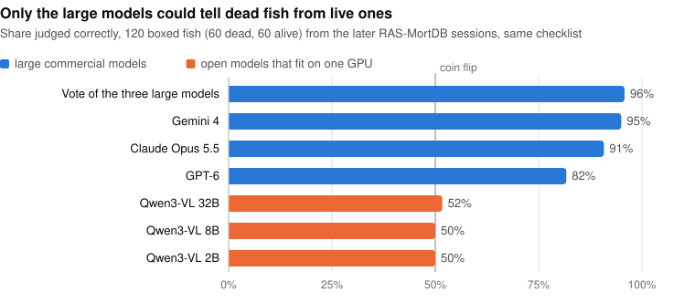
  </picture>
</p>

The three large models scored 82 to 95%. Their majority vote scored 96%: 98% of its "dead" calls were right, and it
found 93% of dead fish. Qwen3-VL scored 50 to 52% at every size. With the checklist, the 2B model called every fish
dead and the 8B model called every fish alive. Without it they did no better (45 to 51%). Only 2 of the 120 fish
fooled all three large models, and at least one of them (the right-hand example above) looks like a labelling error.

<p align="center">
  <picture>
    <source media="(prefers-color-scheme: dark)" srcset="figures/pipeline-dark.svg">
    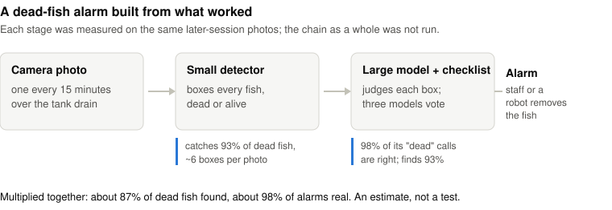
  </picture>
</p>

Putting the two together gives a possible design. A small detector on site boxes every fish, dead or alive. At a low
confidence threshold (0.1) it boxes 93% of dead fish, with about 6 boxes per photo. The large models then check each box. Multiplying the two
stages gives about 87% of dead fish found, with about 98% of alarms real. That figure is an estimate: the votes were
measured on hand-drawn boxes, and I did not run the full chain.

## What's in this repo

```
data/
  splits/               split definitions as file lists (no images)
    brackish_by_video.json        videos and frames in train / val / test
    brackish_label_subsets.json   the 1% and 10% training subsets
    brackish_leakage_test.json    the controlled split test from section 2
    rasmort_by_time.json          capture sessions and dates per split
    fishvista_specimens_used.csv  the museum photos used, with license and source URL
  audits/               video overlap in the Roboflow export, near-duplicate checks
  dead-or-alive-120/    the 120 panels, labels, every model's answers, scores and the prompt
results/
  *.csv                 the tables in this README
  raw/                  one JSON per run, with per-class scores
scripts/                all experiment code; as_run/ holds the exact command lists in the order they ran
figures/                charts and images; make_figures.py redraws the charts from results/
media/                  the video and the GIF
video/                  Remotion source for the video
```

The split files rebuild exactly from the Brackish file names. The test half in `brackish_leakage_test.json` has the
same SHA-256 as the one used in the runs.

## Rerunning

The scripts were written for a Linux GPU machine, with this folder's `scripts/` at `/root/fish/scripts`. Paths are
hard-coded to `/root/fish`.

```bash
bash scripts/setup.sh              # Python env, Brackish + UIEB download, video split, YOLOX + CUT sources
python scripts/sanity_eval.py      # the evaluator must score the ground truth at AP 1.0
bash scripts/get_rasmort.sh        # RAS-MortDB from Zenodo, checksum verified
```

After that, run the command lists in `scripts/as_run/`. `gpu1*.sh` to `gpu4*.sh` were four machines working in
parallel. `ras.sh`, `dead.sh`, `video.sh` and `df3.sh` are the dead-fish runs. Model weights are not included.

## Limits

- One run per setting, so there are no error bars. Differences of about 0.01 AP should be read as ties.
- Each dataset comes from one site and one camera.
- I did not test tracking, speed on edge devices, or an unpaired GAN enhancer (the CUT run did not finish).
- The dead-fish chain was not run end to end, and the 120-fish test uses hand-drawn boxes.

## The Bitter Lesson, in small

This matches Rich Sutton's [The Bitter Lesson](http://www.incompleteideas.net/IncIdeas/BitterLesson.html). The
hand-built ideas didn't help: colour correction, synthetic dead fish, the stay-put rule. Learning from real data did,
and so did the largest general models.

## How this was made

Claude Code wrote the code, ran every experiment on rented cloud GPUs and drafted this page and the video. I
chose what to test, steered the work toward the dead-fish problem, and checked the numbers. Before the runs, two other
large models reviewed the plan with web search. Their reviews led to the controlled split test and to the train/test grid
in the enhancement section.

## Licenses and credits

Code in this repo is MIT licensed. The split files are lists of file names from Brackish and RAS-MortDB.

- The 120 panels in `data/dead-or-alive-120/` and the example images in `figures/` are crops of RAS-MortDB photos
  (CC BY 4.0).
- The enhancement stills, the GIF and the video are adapted from Brackish frames. Brackish is CC BY-SA 4.0 on the
  authors' [Kaggle page](https://www.kaggle.com/datasets/aalborguniversity/brackish-dataset) (the Hugging Face copy
  says CC BY 4.0), so these are shared under CC BY-SA 4.0.

Credits:

- Brackish: M. Pedersen, J. Bruslund Haurum, R. Gade, T. B. Moeslund, N. Madsen, "Detection of Marine Animals in a New
  Underwater Dataset with Varying Visibility", CVPR Workshops 2019. Aalborg University.
- R. Ranjan, "RAS-MortDB: Fish Mortality Detection Dataset and Model Weights for Recirculating Aquaculture Systems",
  v1.1.0, Zenodo 2026, [doi:10.5281/zenodo.21829219](https://doi.org/10.5281/zenodo.21829219).
- Fish-Vista museum photos: per-image license and source in `data/splits/fishvista_specimens_used.csv`.
- Libraries and models: Ultralytics (AGPL-3.0), RF-DETR, YOLOX, Grounding DINO, OWLv2, SAM 3, Qwen3-VL, NAFNet,
  each under its own license.
